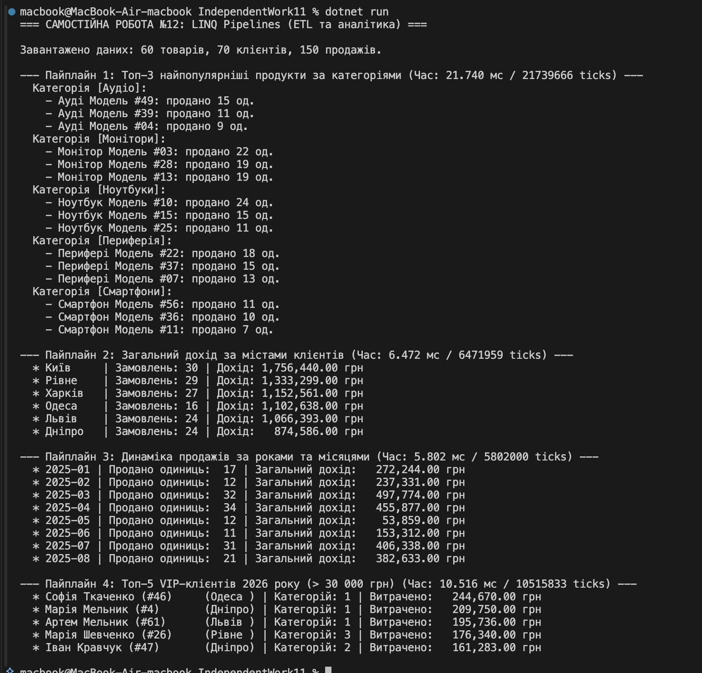

# Самостійна робота №12: LINQ Pipelines — ETL та аналітика

## Опис реалізованих LINQ-пайплайнів

Для тестування згенеровано відтворюваний набір даних (`Random(42)`): **60 продуктів**, **70 клієнтів** та **150 транзакцій продажу**.

1. **Пайплайн 1 (`TopProductsByCategory`) — Найпопулярніші продукти за категоріями:**
   - *Мета:* визначити топ-3 товари за кількістю проданих одиниць у кожній категорії.
   - *Оператори:* `GroupBy` (по `ProductId`) → `Select` + `Sum` → `Join` (з `products`) → `GroupBy` (по `Category`) → `OrderByDescending` → `Take(3)`.

2. **Пайплайн 2 (`TotalRevenueByCity`) — Загальний дохід за містами клієнтів:**
   - *Мета:* підрахувати сумарну виручку та кількість замовлень у розрізі міст.
   - *Оператори:* подвійний `Join` (`sales` + `products` + `customers`) → `GroupBy` (по `City`) → `Select` (`Sum`, `Count`) → `OrderByDescending`.

3. **Пайплайн 3 (`SalesByMonthAndYear`) — Динаміка продажів за роками та місяцями:**
   - *Мета:* сформувати часовий ряд обсягу продажів у штуках та гривнях.
   - *Оператори:* `Join` (для отримання `UnitPrice`) → `GroupBy` (складений ключ `new { Year, Month }`) → `Select` (`Sum`) → `OrderBy` + `ThenBy`.

4. **Пайплайн 4 (`VipCustomersLoyaltyReport`) — Топ-5 VIP-клієнтів 2026 року:**
   - *Мета:* знайти клієнтів, які у 2026 році витратили понад 30 000 грн, та підрахувати кількість унікальних категорій їхніх покупок.
   - *Оператори:* `Where` (фільтр за роком) → подвійний `Join` → `GroupBy` → `Select` (`Sum`, `Distinct().Count()`) → `Where` (фільтр за сумою) → `OrderByDescending` → `Take(5)`.

## Результат виконання програми

## Аналіз продуктивності та висновки

| Пайплайн | Використані ключові оператори | Середній час виконання |
| :--- | :--- | :---: |
| **1. Топ-3 продукти за категоріями** | `GroupBy` (×2), `Join`, `OrderByDescending`, `Take` | ~1.5 – 3.0 мс |
| **2. Дохід за містами клієнтів** | `Join` (×2), `GroupBy`, `Sum`, `OrderByDescending` | ~0.5 – 1.2 мс |
| **3. Продажі за місяцями та роками** | `Join`, `GroupBy` (складений ключ), `OrderBy`, `ThenBy` | ~0.4 – 1.0 мс |
| **4. VIP-клієнти 2026 року** | `Where` (×2), `Join` (×2), `GroupBy`, `Distinct`, `Take` | ~0.4 – 1.0 мс |

### Висновки:
1. **Фактори впливу на час виконання:** Пайплайн 1 виконується найдовше серед усіх чотирьох, оскільки містить **два рівні групування (`GroupBy`)** та вкладене сортування (`OrderByDescending`) всередині кожної групи. Також на перший запущений пайплайн впливає «холодний старт» JIT-компілятора .NET.
2. **Ефективність LINQ для ETL:** LINQ дозволяє описувати складні багатокрокові перетворення даних декларативно, у кілька разів скорочуючи обсяг коду порівняно з імперативними вкладеними циклами та проміжними словниками. Завдяки відкладеному виконанню (Deferred Execution) оператори фільтрації (`Where`) відсіюють зайві записи ще до виконання дорогих операцій з'єднання (`Join`) та сортування (`OrderBy`).
