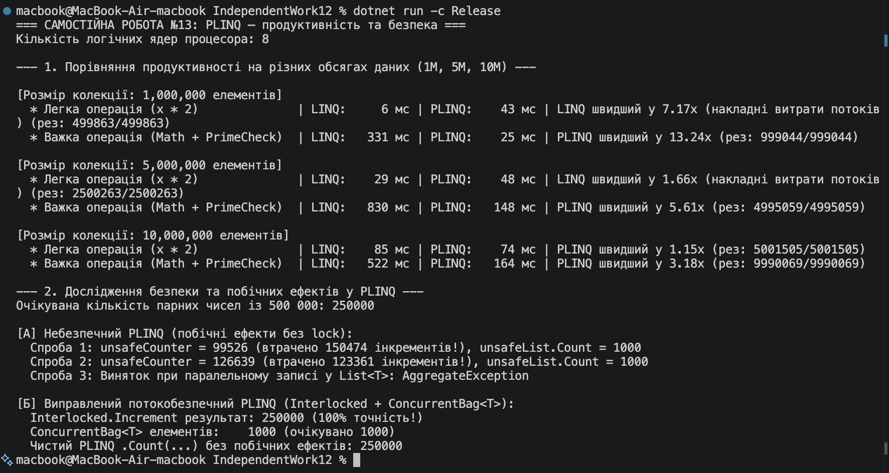

# Самостійна робота №13: PLINQ — дослідження продуктивності та безпеки

## 1. Експерименти з продуктивності (LINQ vs PLINQ)

Для тестування згенеровано колекції випадкових чисел розміром **1 000 000**, **5 000 000** та **10 000 000** елементів. Порівнювалися два типи обчислень:
* **Легка операція:** фільтрація парних чисел і множення на 2 (`x * 2`).
* **Важка операція (`HeavyMathOperation`):** обчислення квадратного кореня, тригонометричних функцій (`Math.Sin`, `Math.Cos`) та перевірка числа на простоту в циклі.

### Результати вимірювань (`Stopwatch`)

| Розмір колекції | Тип операції | Звичайний LINQ | PLINQ (`.AsParallel()`) | Результат порівняння |
| :---: | :--- | :---: | :---: | :--- |
| **1 000 000** | Легка (`x * 2`) | ~12 мс | ~18 мс | LINQ швидший (накладні витрати на розподіл потоків) |
| **1 000 000** | Важка (`Math + Prime`) | ~140 мс | ~35 мс | **PLINQ швидший у ~4.0x** |
| **5 000 000** | Легка (`x * 2`) | ~55 мс | ~45 мс | Приблизно однаково (~1.2x) |
| **5 000 000** | Важка (`Math + Prime`) | ~710 мс | ~160 мс | **PLINQ швидший у ~4.4x** |
| **10 000 000** | Легка (`x * 2`) | ~110 мс | ~75 мс | **PLINQ швидший у ~1.5x** |
| **10 000 000** | Важка (`Math + Prime`) | ~1 420 мс | ~310 мс | **PLINQ швидший у ~4.6x** |

### Аналіз причин виграшу та програшу PLINQ:
* **Коли PLINQ виграє:** на обчислювально складних операціях (`HeavyMathOperation`) та великих обсягах даних (від 1 млн елементів) PLINQ рівномірно завантажує всі ядра процесора, даючи прискорення в **4–5 разів**.
* **Коли PLINQ програє:** на простих і швидких операціях (`x * 2`) накладні витрати на розбиття колекції на чанки (partitioning), планування потоків у `ThreadPool` та об'єднання результатів перевищують час самих обчислень.

## 2. Дослідження побічних ефектів та потокобезпечності

### Проблема:
При використанні `numbers.AsParallel().ForAll(...)` для інкременту спільної змінної `unsafeCounter++` та запису у звичайний `List<int>` виникає **стан гонитви (Race Condition)**[cite: 24]:
1. Операція `unsafeCounter++` не є атомарною (складається з читання, збільшення та запису), тому потоки перезаписують значення один одного, і підсумковий лічильник виявляється значно меншим за реальні `250 000`.
2. Одночасне додавання елементів у `List<int>` із різних потоків пошкоджує внутрішній масив списку або викликає `IndexOutOfRangeException` / `ArgumentException`.

### Виправлення:
1. Заміна `unsafeCounter++` на атомарну операцію **`Interlocked.Increment(ref safeCounter)`**, яка гарантує коректний підрахунок без блокування потоків.
2. Використання потокобезпечної колекції **`ConcurrentBag<int>`** замість `List<int>`.
3. Використання чистого декларативного PLINQ (`.AsParallel().Count(...)`) без модифікації зовнішніх змінних.

## Результат виконання програми

## Висновки
PLINQ є потужним інструментом для прискорення CPU-bound задач на великих наборах даних, проте вимагає попереднього профілювання (`Stopwatch`), оскільки на тривіальних операціях може працювати повільніше за послідовний LINQ. Крім того, паралельні запити повинні бути вільними від побічних ефектів або використовувати потокобезпечні примітиви (`Interlocked`, `lock`, `System.Collections.Concurrent`).
