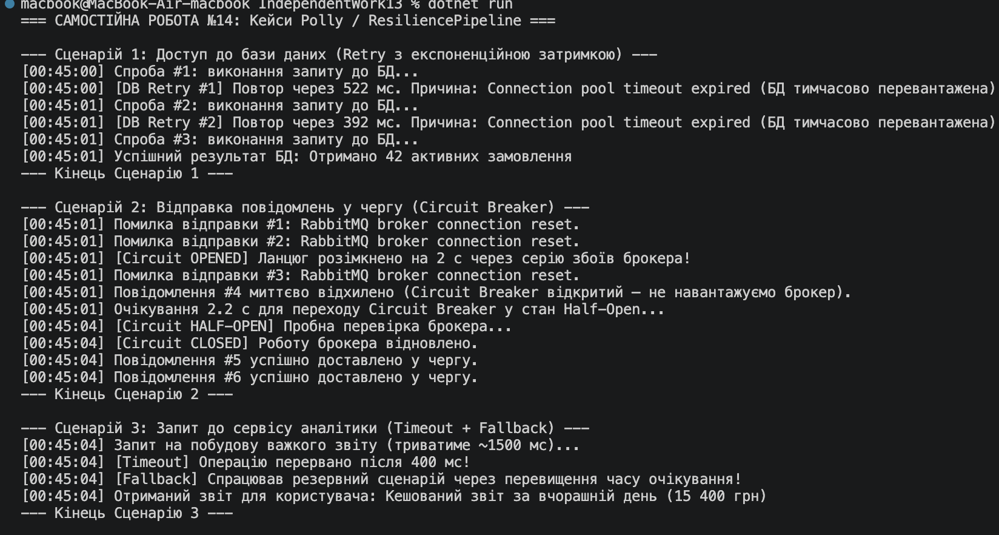

# Самостійна робота №14: Кейси Polly / Retry — звіт про відмовостійкість

## Опис реалізованих сценаріїв

### Сценарій 1: Доступ до бази даних (`Retry` + `Exponential Backoff` + `Jitter`)
* **Опис проблеми:** При пікових навантаженнях пул з'єднань із базою даних може тимчасово відхиляти запити з винятком `TimeoutException`. Одноразова помилка не означає вихід БД з ладу — зазвичай з'єднання відновлюється за лічені мілісекунди.
* **Обґрунтування вибору політики:** Обрано стратегію **Retry** (`MaxRetryAttempts = 3`) з експоненційною затримкою (`DelayBackoffType.Exponential`) та випадковим відхиленням (`UseJitter = true`). Експоненційне збільшення паузи дає БД час розвантажитися, а *Jitter* запобігає ефекту «громового стада» (одночасним повторним запитам від усіх клієнтів).
* **Очікувана поведінка та логи:** Перші дві спроби викликають `TimeoutException`, Polly логує кожен повтор (`[DB Retry #1]`, `[DB Retry #2]`), і на третій спробі запит успішно повертає дані.

### Сценарій 2: Відправка повідомлень у чергу (`Circuit Breaker`)
* **Опис проблеми:** Якщо брокер повідомлень (наприклад, RabbitMQ) недоступний або перевантажений (`IOException`), постійні повторні спроби лише погіршують ситуацію та блокують потоки застосунку.
* **Обґрунтування вибору політики:** Обрано **Circuit Breaker** (`MinimumThroughput = 3`, `BreakDuration = 2s`). Після серії послідовних помилок вимикач переходить у стан `Open` і миттєво відхиляє нові виклики (`BrokenCircuitException`) без мережевого навантаження, а після паузи переходить у стан `Half-Open` для пробної перевірки.
* **Очікувана поведінка та логи:** Перші 3 повідомлення падають із `IOException` → спрацьовує `[Circuit OPENED]` → 4-те повідомлення відхиляється миттєво → після паузи 2.2 с ланцюг переходить у `Half-Open`, 5-те повідомлення проходить успішно, і ланцюг закривається (`[Circuit CLOSED]`).

### Сценарій 3: Довготривалий запит до сервісу аналітики (`Timeout` + `Fallback`)
* **Опис проблеми:** Побудова важкого аналітичного звіту в реальному часі може зависнути на кілька секунд, погіршуючи досвід користувача.
* **Обґрунтування вибору політики:** Поєднано **Timeout** (обмеження очікування 400 мс) та **Fallback** (резервна дія при `TimeoutRejectedException`). Якщо свіжий звіт не встигає сформуватися вчасно, система не показує екран помилки, а повертає актуальний кеш за попередній день.
* **Очікувана поведінка та логи:** Запит тривалістю 1500 мс переривається стратегією `[Timeout]` на 400-й мс, після чого спрацьовує `[Fallback]` і повертає кешований звіт.

## Результат виконання програми

## Висновки
Використання бібліотеки **Polly** дозволяє декларативно відокремити логіку обробки збоїв від основного бізнес-коду. Комбінування стратегій у межах `ResiliencePipeline` (наприклад, `Timeout` + `Fallback` або `Retry` + `Circuit Breaker`) захищає застосунок від каскадних відмов, знижує навантаження на зовнішні сервіси під час аварій і забезпечує стабільну роботу для кінцевого користувача.
