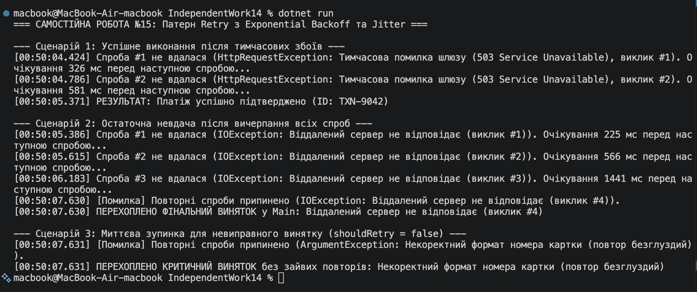

# Самостійна робота №15: Реалізація патерну Retry з Exponential Backoff та Jitter

## Опис реалізації

У класі `RetryPolicy` реалізовано:
* Приватні поля `_maxRetries`, `_initialDelay`, `_jitterFactor` та генератор випадкових чисел `Random`[cite: 26].
* Узагальнений метод `public T Execute<T>(Func<T> operation, Func<Exception, bool>? shouldRetry = null)`[cite: 26].
* Розрахунок часу очікування перед кожною повторною спробою за формулою[cite: 26]:
  $$\text{delay} = \text{initialDelay} \times 2^{\text{retryAttempt}} \times \left(1 + \text{random.NextDouble}() \times \text{jitterFactor} \times 2 - \text{jitterFactor}\right)$$
* Детальне консольне логування номера спроби, типу винятку та фактичної затримки в мілісекундах[cite: 26].

У методі `Main` продемонстровано 3 сценарії[cite: 26]:
1. **Успішне відновлення:** перші 2 спроби імітують `HttpRequestException`, на 3-й спробі операція успішно повертає результат[cite: 26].
2. **Вичерпання спроб:** операція стабільно кидає `IOException`, політика виконує 3 повторні спроби зі зростаючою затримкою та прокидає фінальний виняток назовні[cite: 26].
3. **Фільтрація через `shouldRetry`:** при виникненні `ArgumentException` предикат повертає `false`, тому програма одразу припиняє виконання без марних очікувань[cite: 26].

## Результат виконання програми

## Висновки щодо меж застосування патерну Retry з Exponential Backoff

1. **Де патерн ефективний:** для короткочасних мережевих збоїв (HTTP 502/503/504, розрив TCP-з'єднання, тимчасове блокування рядка в БД), які зазвичай зникають за кілька секунд[cite: 26].
2. **Межі застосування:**
   - **Не підходить для бізнес-помилок та помилок валідації** (`ArgumentException`, HTTP 400/401/403/404) — повторний запит гарантовано дасть ту саму помилку і лише затримає відповідь користувачеві.
   - **Небезпечний для неідемпотентних операцій** без унікального ключа запиту (може спричинити дублювання платежів або замовлень).
   - **Обмеження за часом:** велика кількість повторів (`maxRetries > 5`) без поєднання з патернами `Timeout` або `Circuit Breaker` може призвести до вичерпання пулу потоків застосунку.
