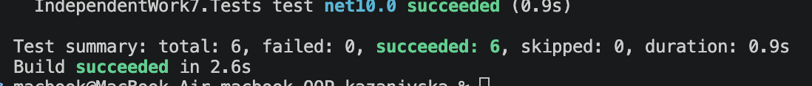

# Самостійна робота №8: Узагальнений кеш `Cache<TKey, TValue>` із тестами

## Опис реалізації

- **`Dictionary<TKey, TValue> _cache`** забезпечує швидкий доступ до значень за ключем зі складністю $O(1)$.
- **`Queue<TKey> _keysOrder`** зберігає порядок додавання ключів для реалізації політики витіснення FIFO (`Dequeue()` найстарішого ключа при досягненні `_capacity`).
- **Юніт-тести (`IndependentWork7.Tests`):** перевіряють додавання/отримання даних (`Add`, `Get`), властивість `Count`, перевірку наявності ключа (`ContainsKey`), викидання `KeyNotFoundException` для відсутнього ключа та витіснення найстарішого елемента при переповненні.

## Результат виконання тестів

