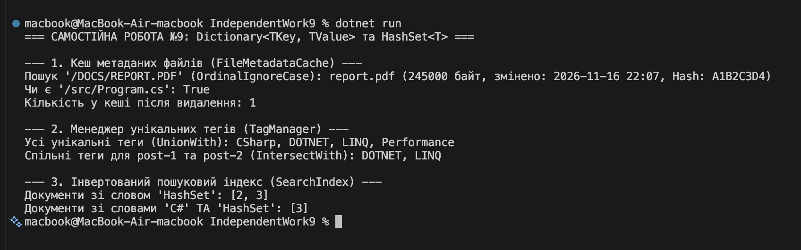

# Самостійна робота №9: Вивчення `Dictionary<TKey, TValue>` та `HashSet<T>` у бібліотеках .NET

## Опис проєкту
У межах роботи реалізовано три практичні сценарії використання узагальнених хеш-колекцій .NET:
1. **`FileMetadataCache`** — кеш метаданих файлів на основі `Dictionary<string, FileMetadata>` з регістронезалежним компаратором `StringComparer.OrdinalIgnoreCase`.
2. **`TagManager`** — система управління унікальними тегами статей на основі `Dictionary<string, HashSet<string>>` із використанням операцій множин `UnionWith` та `IntersectWith`.
3. **`SearchIndex`** — інвертований пошуковий індекс (`Dictionary<string, HashSet<int>>`) для швидкого пошуку документів за одним або кількома ключовими словами.

Детальний аналіз open-source проєктів та порівняльна таблиця складності знаходяться у файлі [REPORT.md](REPORT.md).

## Приклад виводу програми

