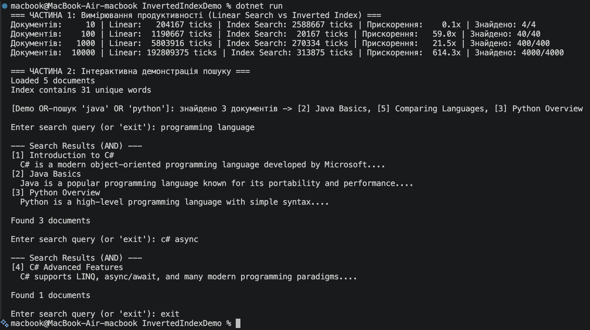

# Самостійна робота №11: Інвертований індекс і вимірювання продуктивності

## Опис проєкту
Консольний застосунок `InvertedIndexDemo` демонструє роботу інвертованого індексу (`Dictionary<string, HashSet<int>>`) для повнотекстового пошуку (`AND`, `OR`, одиночний запит) та порівнює його швидкодію з лінійним пошуком на обсягах від 10 до 10 000 документів.

Детальні результати вимірювань та аналіз наведено у файлі [REPORT.md](REPORT.md).

## Приклад виводу програми

