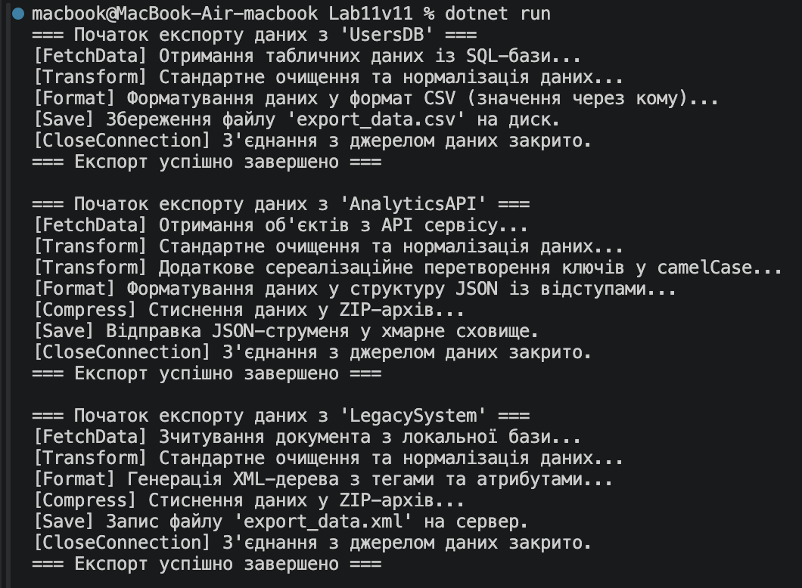

# Лабораторна робота №11

## Опис проекту
У лабораторній роботі реалізовано шаблонний метод для системи експорту даних `DataExporter`. 
Базовий клас визначає послідовність кроків експорту (`FetchData` -> `Transform` -> `Format` -> `Compress` -> `Save`), а конкретні класи (`CSVExporter`, `JSONExporter`, `XMLExporter`) реалізують специфічне форматування та збереження.

## Результат виконання

