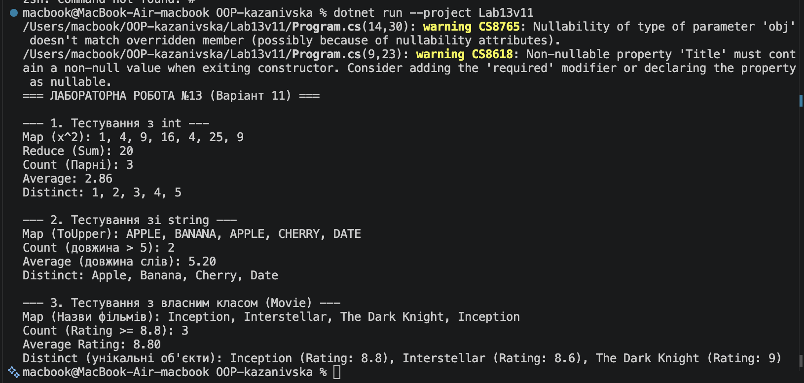

# Лабораторна робота №13

# Опис проєкту 
У лабораторній роботі реалізовано статичний клас **`FunctionalUtils`** із generic-методами вищого порядку відповідно до Варіанту 11:
1. **`Map<T, TResult>`**: Трансформація елементів колекції.
2. **`Reduce<T, TAccumulate>`**: Згортання даних списку у єдине значення.
3. **`Count<T>`**: Підрахунок елементів за заданою умовою.
4. **`Average<T>`**: Обчислення середнього арифметичного за вибірковим числовим полем.
5. **`Distinct<T>`**: Виділення унікальних елементів зі списку.

Усі методи продемонстровано на різних типах даних: `int`, `string` та власному класі `Movie`.

# Результат виконання

