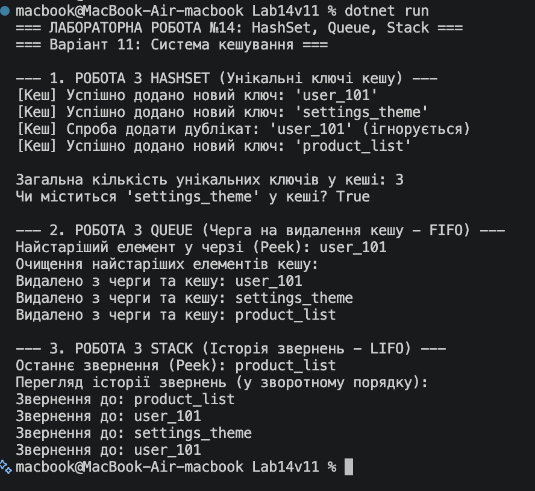

# Лабораторна робота №14: Практичні сценарії HashSet, Queue, Stack

## Мета роботи
Навчитися використовувати спеціалізовані колекції `HashSet<T>`, `Queue<T>`, `Stack<T>` для розв'язання практичних задач, зрозуміти їхні особливості та сценарії застосування.

## Опис  (Варіант №11)

Проєкт реалізує симуляцію **системи кешування** з трьома основними компонентами:

1. **`HashSet<string>` — Унікальні ключі кешу:**
   * Забезпечує миттєву перевірку наявності ключа $O(1)$ та гарантує відсутність дублікатів у кеші.
2. **`Queue<string>` — Черга на видалення (LRU / FIFO):**
   * Обробляє ключі за принципом *First In, First Out*. Використовується для почергового видалення найстаріших елементів кешу.
3. **`Stack<string>` — Історія звернень (LIFO):**
   * Зберігає історію за принципом *Last In, First Out*. Дозволяє переглядати останні звернення у зворотному порядку (від найновішого до найстарішого).

## Результат виконання теми

