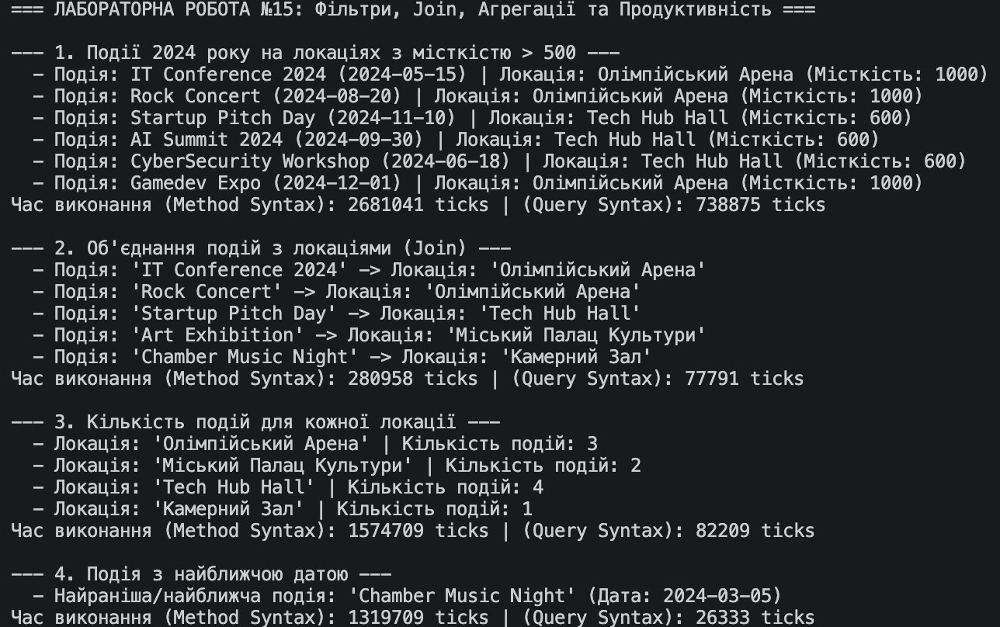

# Лабораторна робота №15: LINQ в дії — Фільтри, Join, Агрегації та Продуктивність

## Опис реалізації (Варіант №11)

Реалізовано дві основні сутності: `Event` (Подія) та `Venue` (Локація)[cite: 15].  
Для виконання вимог лабораторної роботи всі 4 індивідуальні запити написані у двох синтаксисах: **Method Syntax** та **Query Syntax**, а також виміряно час їхнього виконання за допомогою `System.Diagnostics.Stopwatch`.

1. **Фільтрація та об'єднання:** Знаходження подій 2024 року на локаціях з місткістю > 500[cite: 15].
2. **Звичайне об'єднання (`Join`):** Проекція подій та їхніх локацій[cite: 15].
3. **Групове об'єднання (`GroupJoin` / `into`):** Підрахунок кількості подій для кожної локації[cite: 15].
4. **Агрегація / Сортування (`OrderBy` + `FirstOrDefault`):** Пошук події з найближчою датою[cite: 15].

## Результат виконання програми

