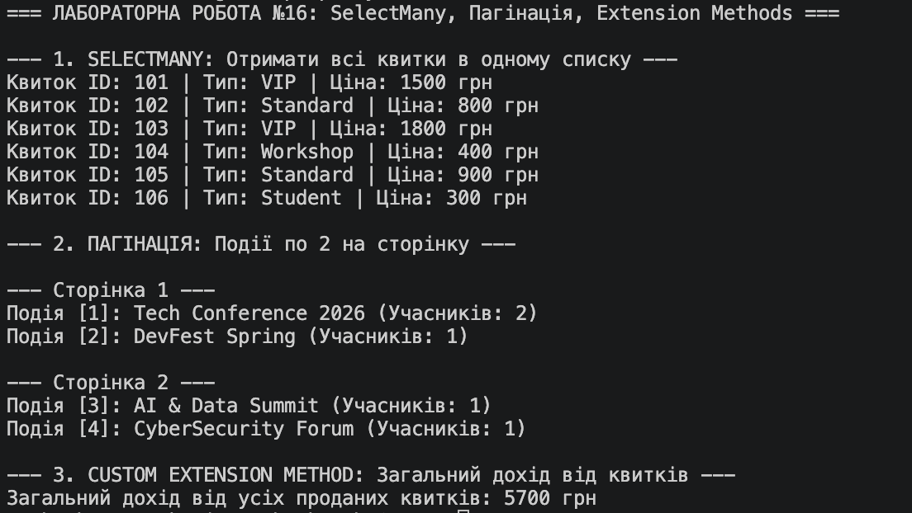

# Лабораторна робота №16: LINQ SelectMany, Пагінація та Extension Methods

## Опис реалізації (Варіант №11)

В рамках роботи створено три сутності: `Event`, `Participant`, `Ticket` з багаторівневою вкладеністю.

1. **`SelectMany` (Розгортання вкладених колекцій):**  
   Використано подвійний `SelectMany` для отримання плоского списку всіх квитків з усіх учасників та подій.
2. **Пагінація (`Skip`, `Take`):**  
   Реалізовано посторінковий вивід подій (по 2 події на сторінку).
3. **Custom Extension Method (`TotalTicketRevenue`):**  
   Створено метод розширення для `IEnumerable<Event>`, який інкапсулює логіку підрахунку загального доходу від продажу квитків.

## Результат виконання програми

