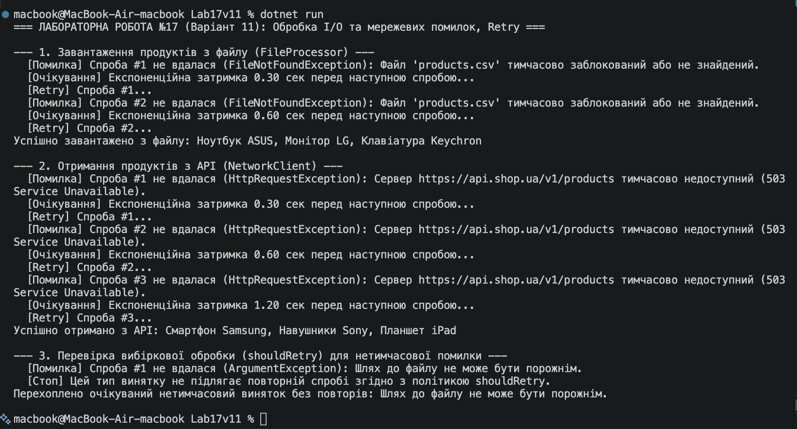

# Лабораторна робота №17: Обробка I/O та мережевих помилок і патерн Retry

## Опис реалізації (Варіант №11)

1. **`FileProcessor` (`LoadProductNames`):** Імітує виникнення `FileNotFoundException` під час перших 2 викликів, після чого успішно повертає список продуктів із файлу.
2. **`NetworkClient` (`GetProductsFromApi`):** Імітує мережевий збій `HttpRequestException` під час перших 3 викликів, а на 4-й спробі успішно повертає дані з API.
3. **`RetryHelper` (`ExecuteWithRetry<T>`):** Реалізує узагальнену логіку повторних спроб з делегатом `shouldRetry` (повторює лише `FileNotFoundException` та `HttpRequestException`) і логуванням кожної невдачі.

## Результат виконання програми

## Висновок щодо експоненційної затримки

У реалізованому варіанті час очікування між невдалими спробами зростає за формулою `initialDelay * 2^attempt` (наприклад, 0.3 с → 0.6 с → 1.2 с). Такий підхід запобігає надмірному навантаженню на диск або зовнішній API під час їхнього відновлення та дає системі достатньо часу для усунення тимчасового збою.

