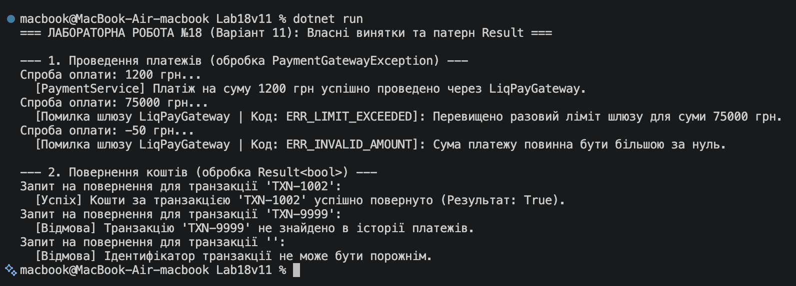

# Лабораторна робота №18: Власні винятки та патерн Result

## Опис реалізації (Варіант №11)

1. **`PaymentGatewayException`:** Власний клас винятку, успадкований від `Exception`, який зберігає назву платіжного шлюзу (`GatewayName`) та код помилки (`ErrorCode`). Реалізовано стандартні конструктори та конструктор із додатковими параметрами.
2. **`Result<T>`:** Узагальнений клас результату операції з властивостями `IsSuccess`, `Value`, `Error`, приватним конструктором і фабричними методами `Success(T)`, `Failure(string)` та `Failure(Exception)`.
3. **`PaymentService`:**
   - `ProcessPayment(decimal amount)` — викидає `PaymentGatewayException` у разі відмови платіжного шлюзу (перевищення ліміту або некоректна сума).
   - `RefundPayment(string transactionId)` — повертає `Result<bool>` для очікуваних бізнес-сценаріїв, коли транзакцію не знайдено в базі.

## Результат виконання програми

## Висновок щодо вибору між винятком та `Result<T>`

Для методу `ProcessPayment` доцільно використовувати власний виняток `PaymentGatewayException`, оскільки відмова зовнішнього платіжного шлюзу або перевищення ліміту безпеки є критичною нештатною подією, яка повинна зупинити транзакцію та передати діагностичний код помилки шлюзу. Натомість для `RefundPayment` краще підходить патерн `Result<T>`, оскільки введення неіснуючого ID транзакції є штатною користувацькою помилкою, яку зручніше й продуктивніше обробити через перевірку `IsSuccess` без генерації Stack Trace.

