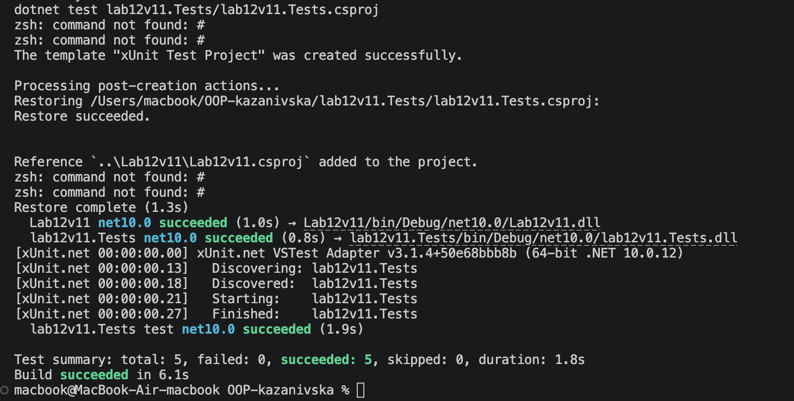

# Лабораторна робота №12

# Опис проєкту
У лабораторній роботі реалізовано узагальнений репозиторій `InMemoryRepository<T>` для управління сутностями фільмів `Movie`. Клас забезпечує виконання базових CRUD-операцій у пам'яті (`Add`, `GetById`, `Update`, `Delete`), а також повністю покритий модулями автоматизованого тестування за допомогою фреймворку **xUnit**.

# Результат виконання

