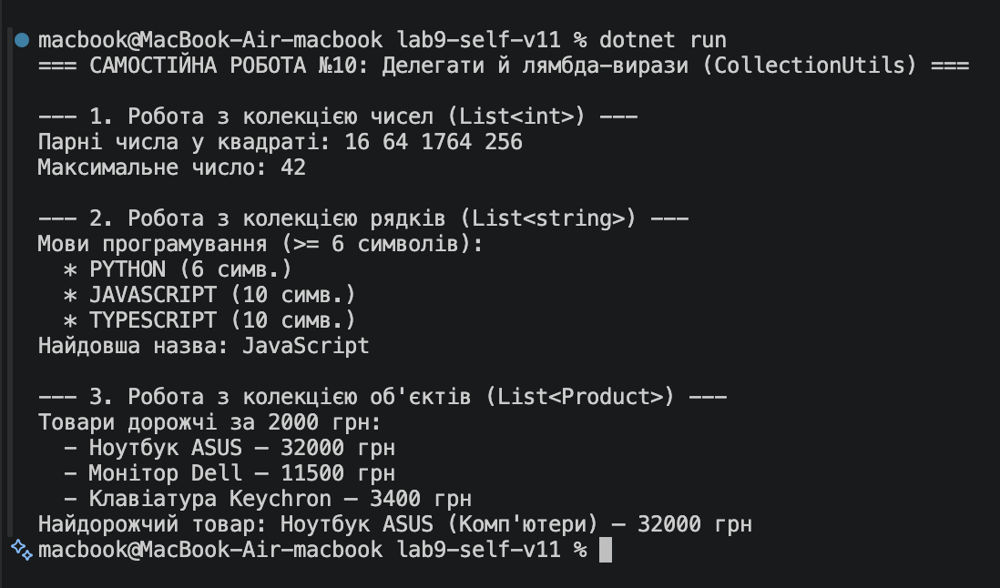

# Самостійна робота №10: Делегати й лямбда-вирази — власні утиліти для колекцій

## Опис реалізації

У класі `CollectionUtils` реалізовано 4 узагальнені методи:
1. **`Map<TSource, TResult>`** — перетворює кожен елемент колекції за допомогою делегата `Func<TSource, TResult>`.
2. **`MaxBy<T, TKey>`** — знаходить елемент із максимальним значенням ключа за допомогою `Func<T, TKey>` та обмеження `where TKey : IComparable<TKey>`.
3. **`Filter<T>`** — повертає елементи, які задовольняють умову `Predicate<T>`.
4. **`ForEach<T>`** — виконує передану дію `Action<T>` для кожного елемента колекції.

Роботу методів продемонстровано на трьох типах колекцій: `List<int>`, `List<string>` та `List<Product>`.

## Результат виконання програми

## Аналіз та порівняння з LINQ (Завдання 4)

### 1. Чому делегати корисні для створення таких утиліт?
Делегати дозволяють відокремити алгоритм обходу колекції від конкретної бізнес-логіки (правила фільтрації, перетворення чи порівняння). Завдяки цьому один узагальнений метод (наприклад, `Filter<T>`) можна багаторазово використовувати для будь-яких типів даних і будь-яких умов без дублювання циклів `foreach`.

### 2. Як лямбда-вирази спрощують виклик цих методів?
Лямбда-вирази (`p => p.Price > 2000m`) дозволяють передавати поведінку безпосередньо в місці виклику методу у вигляді компактного запису замість оголошення окремих іменованих методів або громіздких анонімних делегатів. Компілятор автоматично виводить типи параметрів, що робить код читабельним і лаконічним.

### 3. Порівняння власних методів із вбудованими LINQ-операторами

| Наш метод у `CollectionUtils` | Аналог у `System.Linq` | Основна відмінність у виконанні |
| :--- | :--- | :--- |
| `Map<TSource, TResult>(...)` | `.Select(...)` | Наш метод виконується **негайно** (Eager Execution) і створює новий `List<TResult>` в пам'яті; `Select` використовує **відкладене виконання** (Deferred Execution) через `yield return`. |
| `MaxBy<T, TKey>(...)` | `.MaxBy(...)` (з .NET 6+) | Наш метод повертає `default(T)` або кидає виняток на порожній колекції; вбудований `Enumerable.MaxBy` також підтримує користувацький `IComparer<TKey>`. |
| `Filter<T>(...)` | `.Where(...)` | Наш метод приймає `Predicate<T>` і одразу матеріалізує результат у список; LINQ `Where` приймає `Func<T, bool>` і обчислює елементи ліниво під час ітерації. |
| `ForEach<T>(...)` | `List<T>.ForEach(...)` | Вбудований `ForEach` існує лише для `List<T>`, тоді як наш метод працює з будь-яким `IEnumerable<T>`. |

